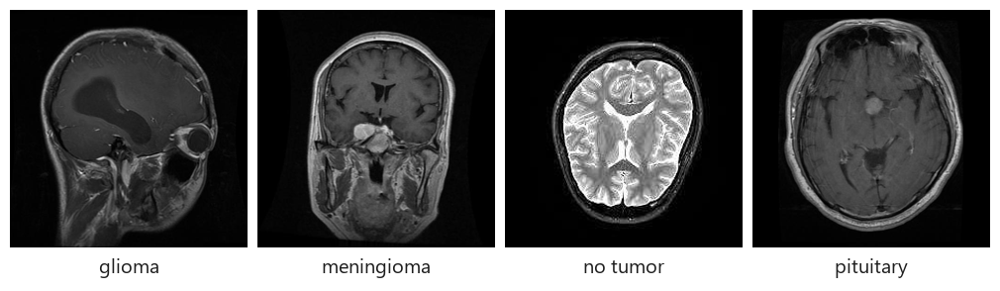
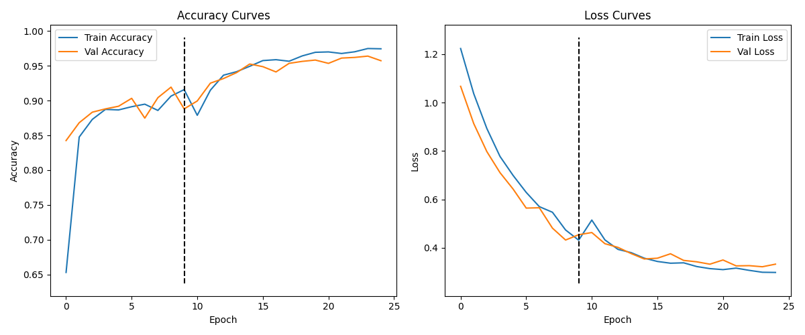
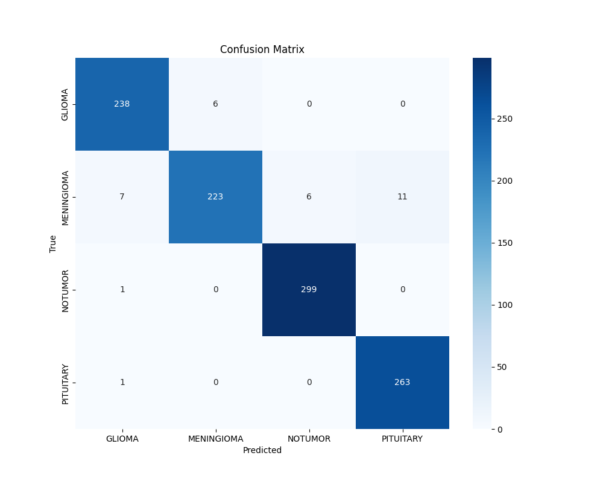
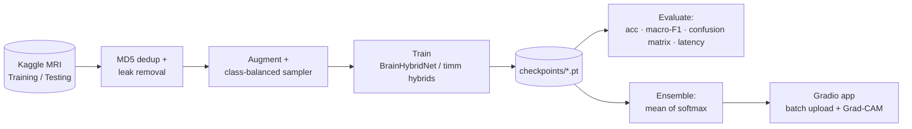
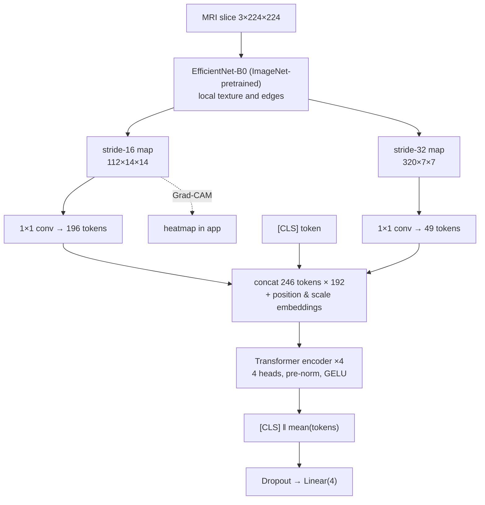

# Brain Tumor MRI Classifier

Classifies brain MRI slices into **glioma**, **meningioma**, **pituitary tumor** or **no tumor**, and shows a Grad-CAM heatmap of where the model looked.

The project has two versions:

| | v1 | v2 (current) |
|---|---|---|
| Framework | TensorFlow / Keras | PyTorch + timm |
| Model | ResNet50V2 transfer learning | **BrainHybridNet**: EfficientNet-B0 CNN + Transformer encoder, optional ensemble |
| Params / compute | ~24.6M / ~4.1 GMACs | **5.5M / 0.37 GMACs** |
| CPU latency (1 image) | ~58 ms | **~28 ms** |
| App | single image, Gradio | batch upload, Grad-CAM, ensembling, Gradio |



> This is a research and learning project, not a medical device. Its predictions are not diagnoses.

---

## Results

### v1: ResNet50V2 (measured)

Two-phase transfer learning: 10 epochs with the backbone frozen, then 15 epochs fine-tuning the top layers (the dashed line in the curves).

| Metric | Value |
|---|---|
| Test accuracy | **97.0 %** (1,023 / 1,055) |
| Glioma recall | 97.5 % |
| Meningioma recall | 90.3 % |
| No-tumor recall | 99.7 % |
| Pituitary recall | 99.6 % |

| Training curves | Confusion matrix (test set) |
|---|---|
|  |  |

Meningioma is the weak class: it gets confused with glioma and pituitary. Those tumors can look alike on a single 2D slice.

**Caveat I found later:** v1 merged Kaggle's `Training/` and `Testing/` folders and re-split them at random. The dataset contains exact-duplicate images, so some test images also appear in training, which inflates this number. Fixing that is one of the main reasons for v2.

### v2: BrainHybridNet (efficiency measured, accuracy pending a full training run)

| Model | Params | GMACs @224 | CPU latency (1 img, 4 threads) |
|-------|-------:|-----------:|-------------------------------:|
| v1 ResNet50V2 + head | ~24.6M | ~4.1 | 58.3 ms* |
| **BrainHybridNet** | **5.51M** | **0.37** | **27.5 ms** |
| MobileViTv2-1.0 | 4.39M | 1.41 | 34.3 ms |
| EfficientFormerV2-S1 | 5.74M | 0.65 | 34.2 ms |
| FastViT-T8 | 3.26M | 0.53 | 27.9 ms |

\*torchvision ResNet-50 used as a same-size proxy for the Keras model. All timings come from the same laptop CPU via `hybrid.evaluate.measure_latency`.

Running `python -m hybrid.train` writes the test accuracy, macro-F1 and confusion matrix to `checkpoints/<arch>_results.json`.

---

## v2 architecture

### Pipeline



### BrainHybridNet



**Why a hybrid?**
- The **CNN** brings a strong bias for local texture, which works well on a small dataset (~5.6k training images).
- The **Transformer** applies self-attention across the whole image, so the model can relate a lesion to the rest of the brain (position, symmetry, midline). Glioma vs. meningioma depends partly on location, so global context matters there.
- **Two token scales**: small pituitary lesions are visible at stride 16, large gliomas at stride 32. Both feed the attention layers.

More detail: [`docs/architecture.md`](docs/architecture.md).

### What changed from v1 and why

| Problem in v1 | Fix in v2 |
|---|---|
| Train/test leakage from merging and re-splitting folders | Keep the official split, remove MD5 duplicates, and drop training images that also appear in the test set |
| Training used `preprocess_input` ([-1, 1]) but the app used `/255` ([0, 1]) | One shared `eval_transform` used by evaluation and the app |
| A second softmax layer was appended to the model by mistake | Clean single head |
| Model chosen by accuracy only | Early stopping on **validation macro-F1**, plus a class-balanced sampler and label smoothing |
| Hard-coded Windows paths, app bound to a public share link | Relative paths, binds to localhost by default |
| Large model (24.6M params) | 5.5M params, ~11× fewer MACs, ~2× faster on CPU |

Training setup: AdamW, warmup + cosine LR, label smoothing 0.1, mixed precision on GPU, gradient clipping, and MRI-safe augmentation (small rotations, resized crop, flip, brightness/contrast).

---

## Usage

```bash
pip install -r requirements.txt
```

**Dataset:** [Brain Tumor MRI Dataset (Kaggle)](https://www.kaggle.com/datasets/masoudnickparvar/brain-tumor-mri-dataset), 1,400 train + 400 test images per class. Keep the original layout:

```
brain-tumor-mri-dataset/
├── Training/{glioma,meningioma,notumor,pituitary}/
└── Testing/{glioma,meningioma,notumor,pituitary}/
```

**Train** (one model, or several to ensemble):

```bash
python -m hybrid.train --data path/to/brain-tumor-mri-dataset --arch brainhybrid
python -m hybrid.train --data path/to/brain-tumor-mri-dataset --arch fastvit
```

**Evaluate an ensemble:**

```bash
python -m hybrid.evaluate --data path/to/brain-tumor-mri-dataset \
  --ckpts checkpoints/brainhybrid.pt checkpoints/fastvit.pt
```

**Run the app:**

```bash
python app.py                 # http://127.0.0.1:7860
HOST=0.0.0.0 python app.py    # inside Docker / on a server
```

**Tests:** `pytest tests -q`

## Project layout

```
app.py              Gradio app (v2): batch upload, ensemble, Grad-CAM
hybrid/model.py     BrainHybridNet, timm hybrid backbones, Ensemble
hybrid/data.py      leak-free splits, transforms, balanced loader
hybrid/train.py     training loop
hybrid/evaluate.py  metrics, confusion matrix, latency, ensemble eval
tests/              unit tests (output shapes, model size, ensemble, checkpoints, leak-free split)
docs/               architecture diagrams and result images

v1 (TensorFlow):    main.py, train.py, model_builder.py, data_loader.py,
                    callbacks.py, evaluate.py, visualize.py, gradio_app.py, config.py
```

## Next steps

- Full training run of all four v2 architectures on the official split.
- Temperature scaling for calibrated probabilities, plus an "is this even an MRI?" out-of-distribution check.
- ONNX / INT8 export for faster CPU serving.
- Cross-dataset testing (Figshare, BraTS slices) to check generalisation.
